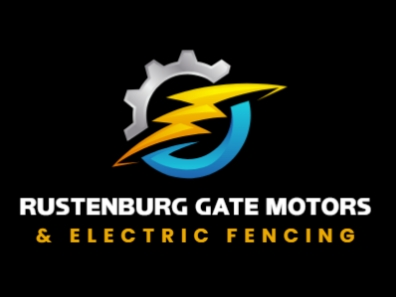
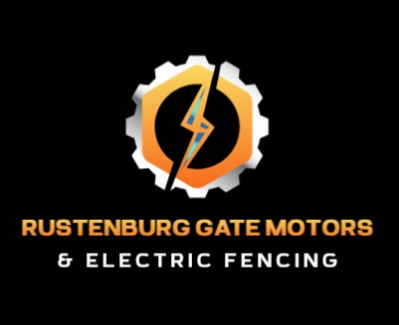
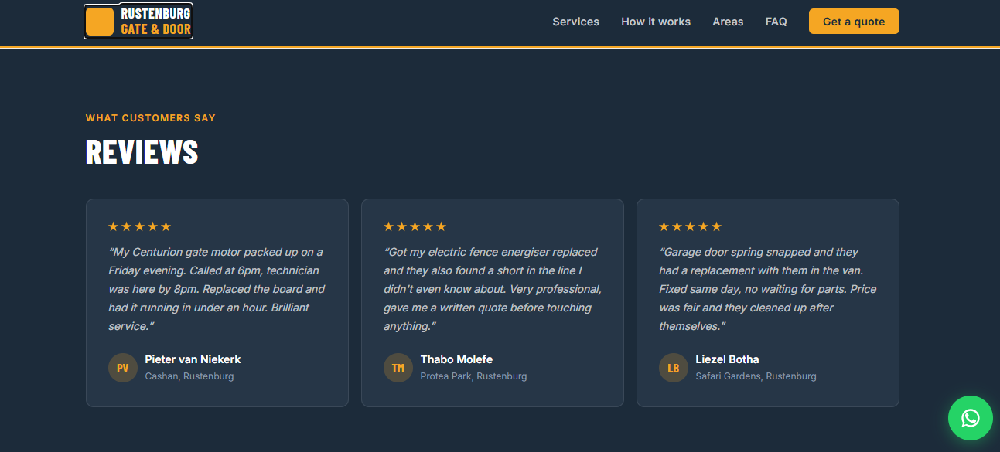
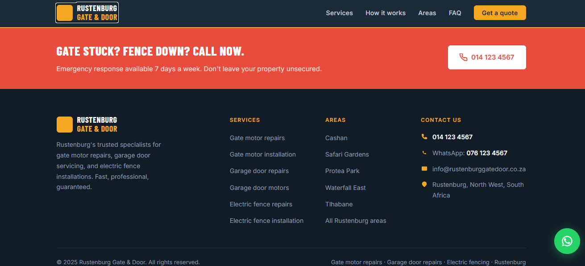

# Rustenburg Gate & Door
### Website Design, Brand Identity & Digital Deployment Project

## 1. Project Overview

This project involved planning, designing and creating a professional digital presence for a fictional gate, garage door and electric fencing business based in Rustenburg, South Africa.

The objective was to develop a clear and accessible online presence that introduces the business, communicates its services, explains the customer process and provides convenient ways for potential customers to make enquiries.

The project included website planning and creation, content organisation, customer journey planning and the development of two alternative logo concepts.

The website was independently planned, designed and assembled using Hostinger, without AI-generated code.

A saved HTML version of the website was subsequently published through GitHub Pages, making it accessible online through a public web address.

## 2. From Saved HTML File to Live Website – GitHub Pages Deployment

One of the most interesting parts of this project was taking a saved HTML version of the website and turning it into a publicly accessible website using GitHub Pages.

The original website was independently planned, designed and assembled using Hostinger. I had retained a saved HTML file of the website, which provided an opportunity to explore another way of making it accessible online.

Rather than simply keeping the file on my computer, I uploaded it to the existing GitHub project repository, configured the repository to use the HTML file as its homepage (`index.html`), and enabled GitHub Pages.

GitHub Pages takes the HTML file stored in the repository and publishes it as a live webpage. This means that visitors can open the website through a normal web browser using a public website address, without needing access to the original website builder.

### The Result

The saved HTML file became a publicly accessible website:

**[View the Live Rustenburg Gate & Door Website](https://cindy3885.github.io/Rustenburg-gate-door-website/)**

This practical exercise demonstrated how an existing website file can be taken beyond local storage and published online using GitHub's built-in hosting functionality.

### What This Demonstrates

- Understanding how HTML files are used to display webpages in a browser.
- Working with GitHub repositories and file management.
- Configuring GitHub Pages to publish a website.
- Setting up an HTML file as the website's main homepage.
- Turning a locally saved website file into a publicly accessible online presence.
- Exploring practical ways to reuse existing digital assets and make them accessible online.

**A small saved file, a little exploration and a practical application of GitHub Pages turned into a live website.**

## 3. Website Design & Creation

The website was designed to provide visitors with information about the business and its services while making it easy to understand the process and get in touch.

The website included:

- Homepage
- Services page
- How It Works page
- Areas Covered page
- Frequently Asked Questions page
- Get a Quote page
- WhatsApp chat widget
- Mobile website layout

### Website Features

The website structure focused on:

- Clear presentation of business services
- Straightforward website navigation
- Customer-friendly information
- Enquiry and quotation pathways
- Calls to action
- Accessible customer communication
- Desktop and mobile presentation

## 4. Brand Identity & Logo Concepts

Two alternative logo concepts were independently created for the Rustenburg Gate & Door business concept.

The concepts explore possible visual identities for a business operating in the gate motor, garage door and electric fencing industry.

These designs were developed as part of the wider digital presence project. They were not incorporated into the website itself.

### Logo Concept 1

### Logo Concept 2

## 5. Website Screenshots

The following screenshots document the original website's desktop and mobile presentation.

### Homepage

### Website Pages

### Customer Communication

### Mobile Website Views

## 6. Skills Demonstrated

### Website & Digital Presence
- Website planning and structure
- Website design and creation
- Hostinger
- Page layout and navigation
- Content organisation
- Desktop and mobile presentation
- HTML File Handling & Website Publishing
- GitHub Repository Management
- GitHub Pages Configuration & Deployment
- Website Homepage Setup (index.html)
- Digital Presence Development
- Brand Identity Exploration & Creative Design
- Website Layout, User Experience & Mobile-Friendly Design
- WhatsApp Business Integration Concept
- Customer Enquiry & Quote Workflows
- Practical Problem-Solving & Independent Learning
- Exploring & Applying Digital Toos to Business Needs

### Brand Identity
- Logo concept development
- Visual identity exploration
- Creative design

### Customer Experience
- Customer journey planning
- Calls to action and enquiry pathways
- Customer communication features
- Website information architecture
- Customer-focused content presentation

## 7. Project Status & Notes

- This is a fictional business concept developed for portfolio demonstration.
- The website was originally created using Hostinger.
- The original Hostinger hosting has expired, and the website administration area is no longer accessible.
- The website screenshots are retained as documentation of the original design and presentation.
- The two logo concepts are additional creative work developed for the same business concept.
- The logo concepts were not incorporated into the original website.

## 8. Project Details

| Detail | Description |
|---|---|
| Project | Rustenburg Gate & Door |
| Project Type | Website Design, Brand Identity & Digital Presence |
| Business Concept | Gate motors, garage doors and electric fencing |
| Location | Rustenburg, South Africa |
| Original Website Platform | Hostinger |
| Website Publishing| GitHub Pages |
| Website File| HTML (index.html) |
| Brand Identity - Logo Concepts | 2 |
| Website Screenshots | 24 |
| Project Status | Portfolio project |
| Live Website | https://cindy3885.github.io/Rustenburg-gate-door-website/ |

---

*This project demonstrates practical website planning, digital presence design, brand identity exploration and the creation of customer-focused online experiences.*
