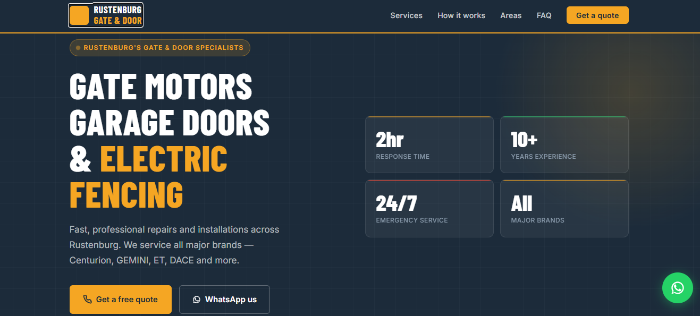

# Rustenburg Gate & Door
### Website Design & Creation Project

## 1. Project Overview

This project involved planning, designing and creating a professional website for a fictional gate and garage door business based in Rustenburg, South Africa.

The objective was to create a clear and accessible online presence that introduces the business, communicates its services, explains the customer process and provides convenient ways for potential customers to make enquiries.

The website was independently planned, designed and assembled using Hostinger, without AI-generated code.

## 2. What I Created

The website included:

- Homepage
- Services page
- How It Works page
- Areas Covered page
- Frequently Asked Questions page
- Get a Quote page
- WhatsApp chat widget
- Mobile website layout

## 3. Skills Demonstrated

- Website planning and structure
- Website design and content organisation
- Hostinger
- Page layout and navigation
- Customer journey planning
- Calls to action and enquiry pathways
- Customer communication features
- Desktop and mobile presentation

## 4. Project Screenshots

The following screenshots document the website's original desktop and mobile presentation.

### Homepage

### Website Pages

### Customer Communication

### Mobile Website Views

## 5. Project Status & Notes

- This is a fictional business concept developed as a portfolio project.
- The original website was created using Hostinger.
- The original Hostinger hosting has expired, and the website administration area is no longer accessible.
- The screenshots are retained as documentation of the original website.
- A separate working demonstration may be explored using the saved website files, depending on file and asset availability.

## 6. Project Details

| Detail | Description |
|---|---|
| Project | Rustenburg Gate & Door |
| Project Type | Website Design & Creation |
| Platform | Hostinger |
| Business Concept | Gate and garage door services |
| Location | Rustenburg, South Africa |
| Documentation | 24 website screenshots |
| Status | Portfolio project |

---

*This project demonstrates practical website planning, design, content organisation and the creation of a customer-focused digital presence.*
